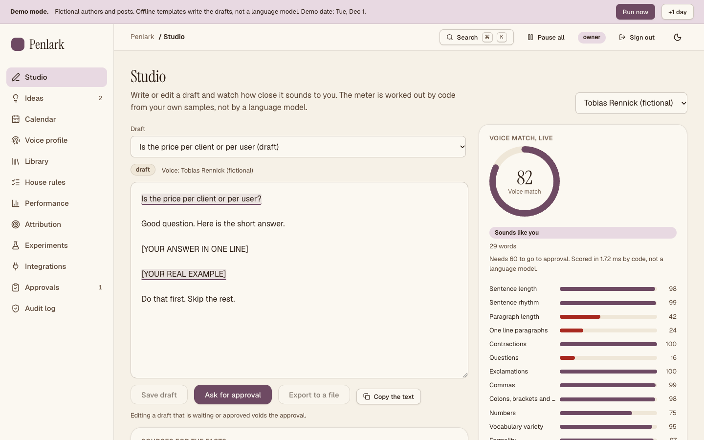
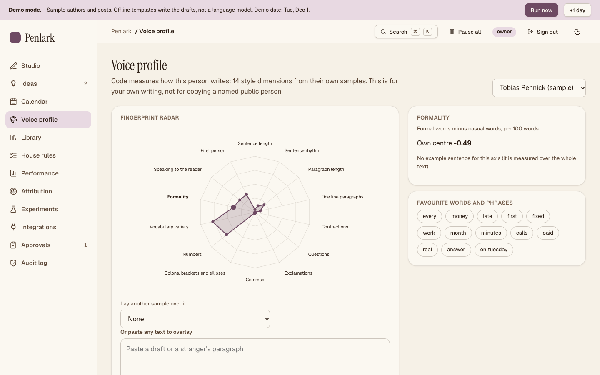

# Penlark

Write in your own voice, with a person approving everything. Penlark learns how one person writes, turns the calls, comments and emails they get into ranked ideas, drafts in their style, scores every sentence against their voice as they type, and refuses to let a number or a client story through unless it comes from a real note. It never publishes by itself.

Everything in the demo is fictional. The offline writer is a set of templates, not a language model.



## What is inside
- **Studio** with a live voice match meter, house rule underlines and a variant diff.
- **Voice fingerprint radar** of <!--n:dimensions-->14<!--/n--> style dimensions, with a guide you edit and lock.
- Ideas with verbatim evidence, a calendar for approved drafts, a library, house rules, performance and a learning loop that shows sample sizes, tracked links and a lead funnel, A/B experiments, approvals and an audit log.
- Scheduler adapters for Postiz, Buffer and Metricool (tested against local stand ins only) and a file export that is the default.



## Honest numbers (`docs/EVALUATION.md`)
Held out voice match: <!--n:eval.voice.correct-->24<!--/n--> of <!--n:eval.voice.of-->24<!--/n--> authors right, mean AUC <!--n:eval.voice.auc-->0.975<!--/n-->, with caveats: short fictional texts, and generic machine sounding prose still scored <!--n:eval.voice.generic_mean_best-->79.0<!--/n--> against a formal profile. Tests: <!--n:tests.passed-->428<!--/n--> passed, coverage <!--n:tests.coverage_percent-->95.3<!--/n--> percent, <!--n:e2e.tests-->46<!--/n--> browser tests. Independent held out sets (A first run, B first run): `docs/INDEPENDENT-EVAL.md`; generic machine text is stopped by the house rules, not reliably by the voice match. Nothing was run against a real vendor or a real model key: Postiz, Buffer and Metricool are UNVERIFIED live, and no real host was deployed to (the GitHub workflow builds the Docker images and starts the stack on a GitHub machine).

## Try it
```
make install
pnpm build
make api        # one terminal
make web        # another terminal, then open http://localhost:3000
```
Sign in as `owner@example.test`, password `demo-password-1` (the demo only: it stops working the moment `OWNER_PASSWORD_HASH` is set). For your own install see `docs/05-RUN-LOCALLY.md`. Full steps: `docs/01-QUICK-DEMO.md`.

## Docs
Start at `docs/00-START-HERE.md`. Setup, deploy (Vercel, Railway, Hetzner), go live, security and limits are numbered 00 to 15. Reference: `docs/ARCHITECTURE.md`, `docs/CAPABILITIES.md`, `docs/TOOLS-AND-ALTERNATIVES.md`, `docs/DESIGN-NOTES.md`, `docs/EVALUATION.md`, `docs/GLOSSARY.md`, `docs/FACTS-AND-SOURCES.md`.

## Hard limits
Never invents personal facts or results. Nothing publishes without a person. Reads only what you own or provide. For your own voice, not a named public person. Each social network needs its own app approval through your scheduler tool.

MIT licence.
