# Capabilities

<!--n:pages-->12<!--/n--> pages. Screenshots are in `screenshots/` (<!--n:screenshots-->41<!--/n--> files, desktop 1440 by 900 and phone 390 by 844, light and dark).

## Studio (signature: live voice match meter)
Edit a draft. The ring, the <!--n:dimensions-->14<!--/n--> bars and the underlines update as you type. Underlines: sentences that pull the score down (plum), banned phrases and dashes (red), claims with no source (amber). Compare a variant word by word. Attach notes as sources. Ask for approval. Export to a file.
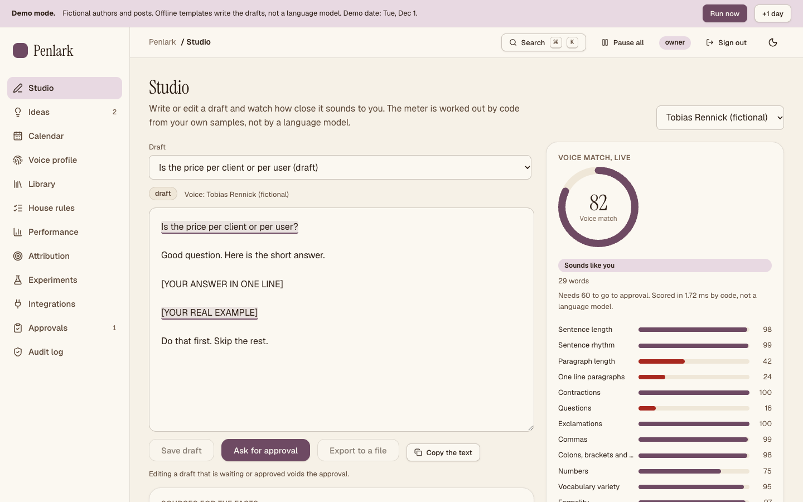
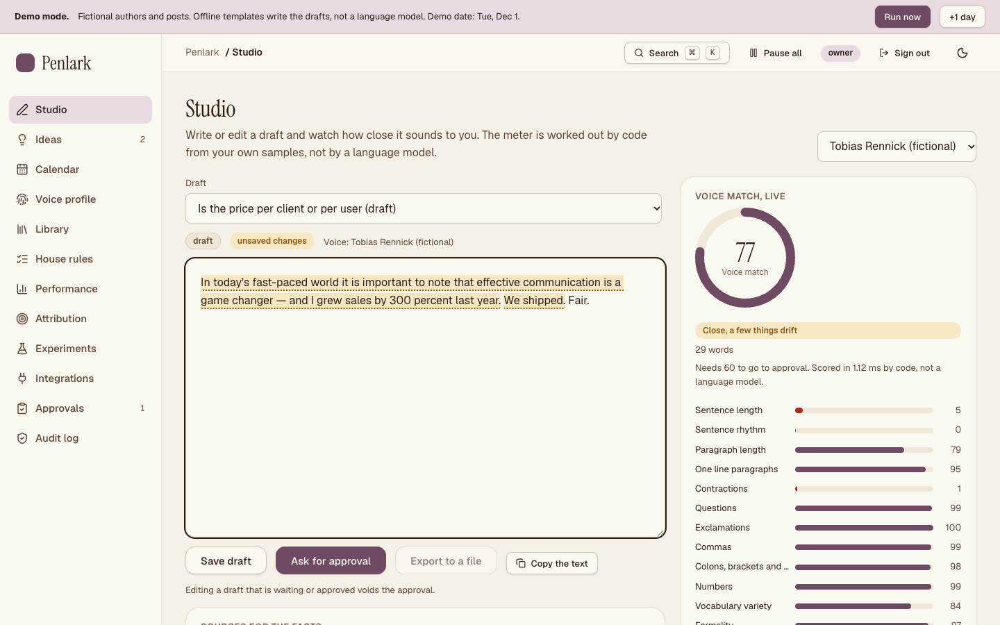

## Ideas
Ranked themes from your notes, each with verbatim quotes and the rubric numbers. Write a draft in a chosen voice and kind. Add notes. Drop an idea.
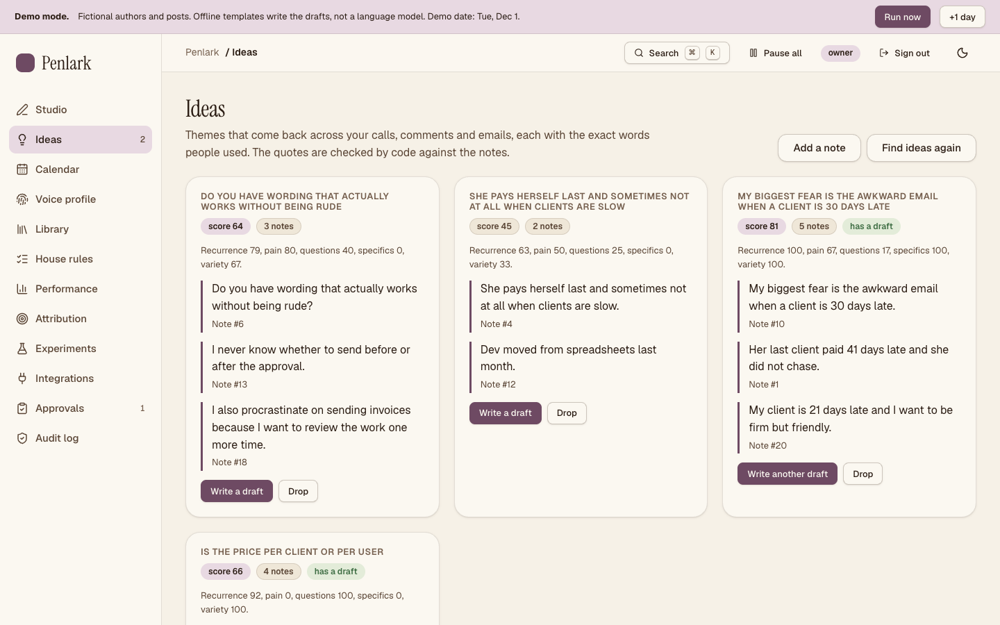

## Calendar
Week and month. Drag an approved draft onto a day or move a planned item, with a keyboard route and an Undo toast. It plans, it never sends. Choose the platform before you plan. A rhythm strip shows the planned posts against the weekly target for each platform (default two a week on LinkedIn and two on X, set with `CADENCE`). It is a plan and a nudge, never a block.
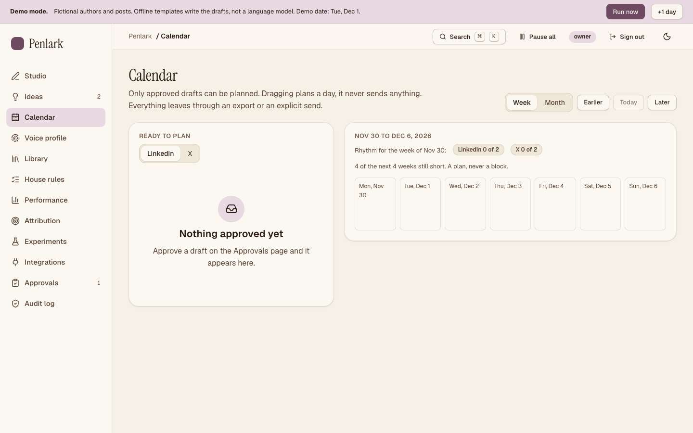

## Voice profile (signature: fingerprint radar)
The radar of style dimensions with your voice filled and any sample or pasted text overlaid. Click an axis for its plain meaning and real example sentences. Edit the guide, lock the profile, build a new version and see what changed.
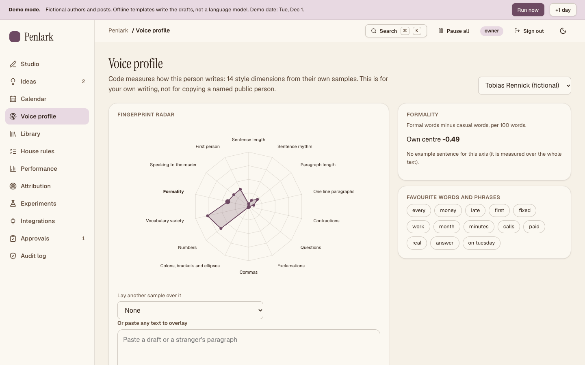

## Library
Your writing samples. Paste, or upload text, markdown, PDF, a transcript, a LinkedIn Shares.csv or an X archive.
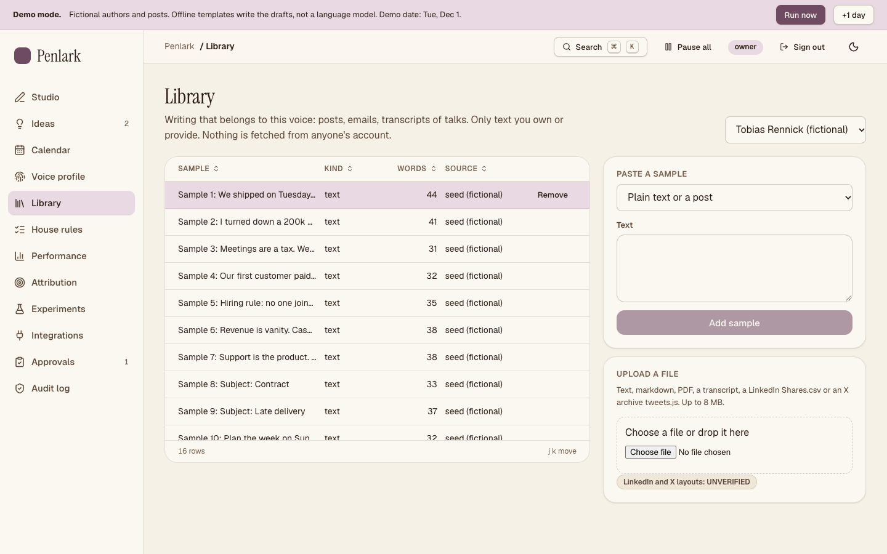

## House rules
Built in banned phrases (<!--n:seed.banned_phrases-->130<!--/n-->) and patterns (<!--n:seed.banned_patterns-->5<!--/n-->), your own, and the settings (dashes banned in marketing text, reading level grade 9 or lower, a voice match of at least 60). They are decided defaults the implementer changes for each client.
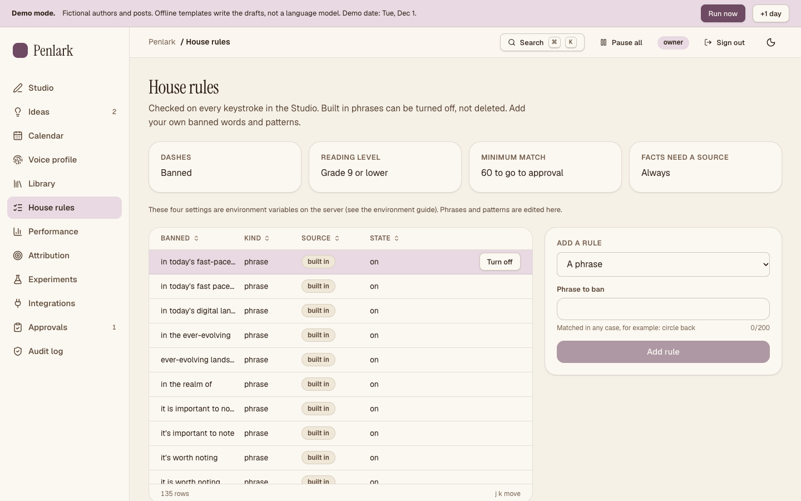

## Performance
Import post numbers from a CSV with a column check. Charts, a table that handles 5,000 rows, and the learning loop with sample size bars and a strict bar for patterns.
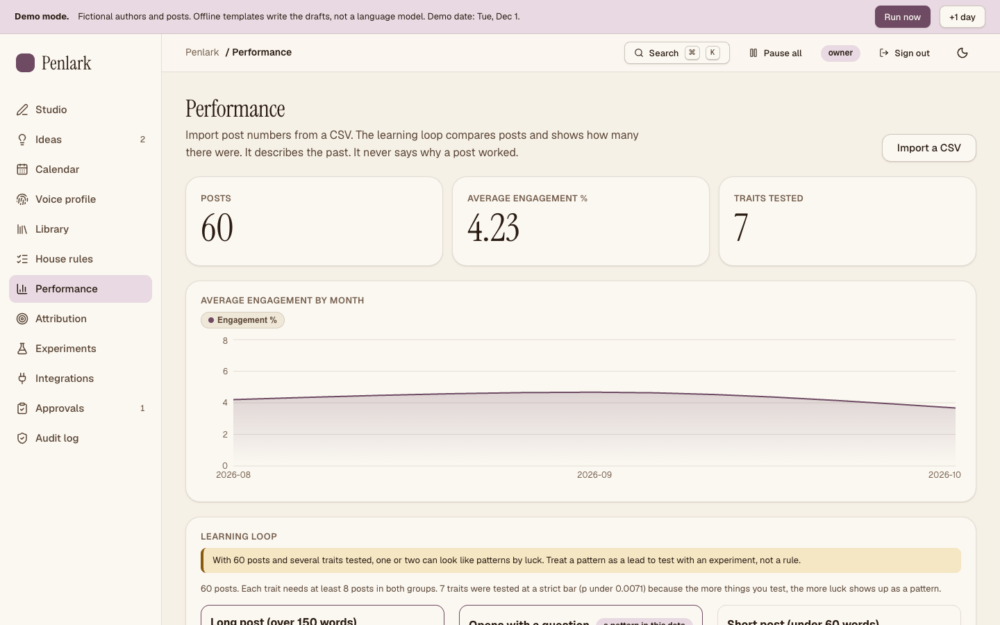

## Attribution
Make tracked links on your allow list, see clicks, unique visitors, leads and customers per link.
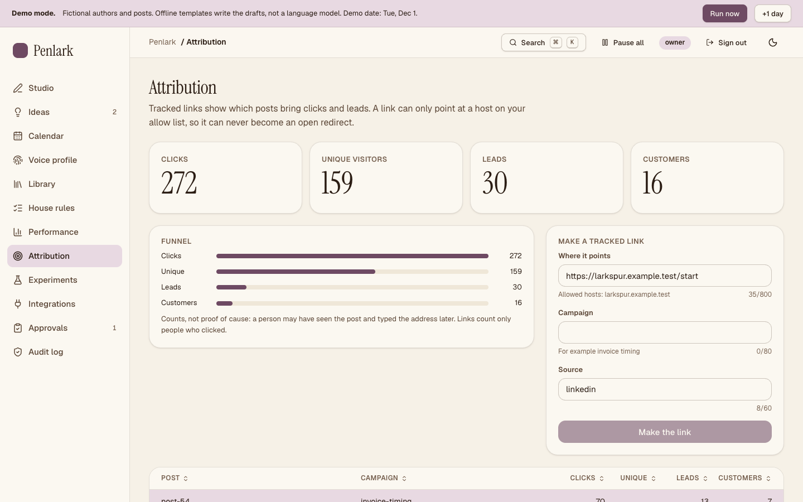

## Experiments
A/B counts with an honest note: too few to call, no clear difference, or a difference.
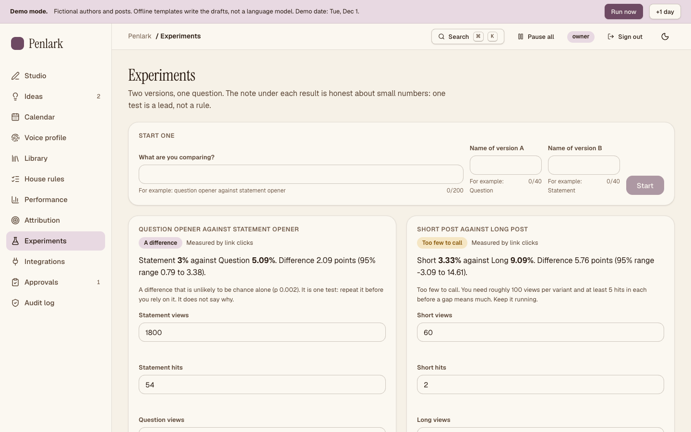

## Integrations, Approvals, Audit log
Test the selected scheduler. Approve or reject (never your own request). A hash chained log you can verify.
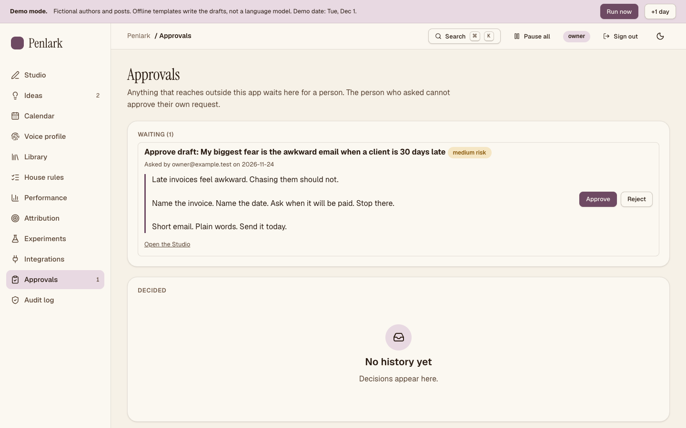

## Everywhere
Command palette (Cmd or Ctrl plus K, with pages, theme, sign out, kill switch and the demo actions), G then a number to go to a page, keyboard use, light and dark, reduced motion, a kill switch (it stops every send to a scheduler; writing, approving and exporting to a file keep working), demo bar with the demo date.

## Roles and safety on screen
The owner and the approver can change things; the viewer sees every page and every write control is switched off with a reason. Editing a draft that waits for approval withdraws the request, so an approver never approves words they did not see. The Approvals page shows the draft text. Nothing is published from the screens: Export to a file saves text for you to copy (there is also a Copy the text button).
